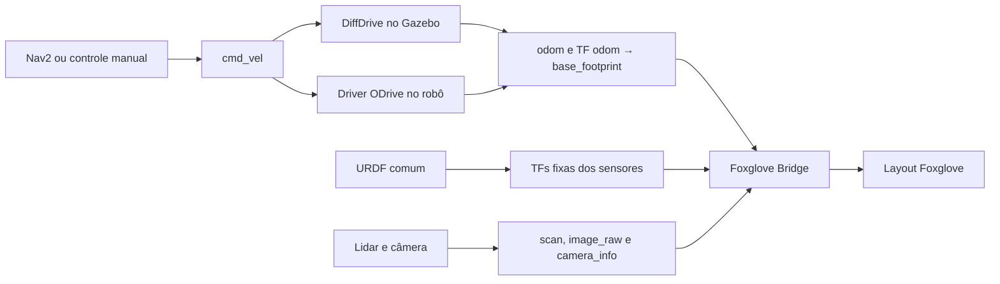

# Conexões e controladores

O fluxo ROS foi verificado em software e o bringup básico foi testado na
Nano, com câmera, LiDAR, TFs e ODrive em IDLE. Houve também um avanço curto
supervisionado pelo driver ROS. Esses ensaios estão no
[inventário de outubro/2026](hardware.md); calibração, giros e navegação
física continuam pendentes.

## Caminho comum



Gazebo e ODrive são alternativas, em domínios distintos: simulação básica 28,
LabSEA semântico 68 e robô 27. A simulação não inicia o driver físico. O padrão de `/cmd_vel`
é `geometry_msgs/msg/Twist`, com velocidade linear em m/s e angular em rad/s.

| Ligação | Estado |
|---|---|
| Comando → DiffDrive → odometria | Avanço, giro e parada testados no Gazebo |
| Sensores simulados → ROS → TF | Câmera/lidar, resolução e frames testados |
| ROS → Foxglove | Nove tópicos e recuperação da malha testados pelo protocolo |
| Timeout e encerramento do driver ODrive | Testados com substitutos de hardware |
| ODrive/YDLidar/C920 físicos | Bringup básico conjunto passou na Nano; calibração e navegação pendentes |
| Nav2 → suavizador → comando final | Remappings corrigidos e fluxo testado em domínio isolado |
| SLAM → mapa salvo → AMCL → Nav2 → Gazebo | Três destinos, cancelamento/parada e destino inválido testados |
| Fluxo semântico com oráculo | Aproximação, memória após reinício, cancelamento e timeout testados |
| Fluxo semântico com detector aprendido | Cadastro e recuperação passaram no LabSEA simulado; hardware físico pendente |

## Correções da revisão

O launch de navegação passa a usar este caminho:

```text
controller_server / behavior_server → cmd_vel_nav
velocity_smoother: cmd_vel_nav → cmd_vel
```

Antes, os comandos iam direto a `/cmd_vel` e a saída `/cmd_vel_smoothed`
não chegava à base. A correção liga o suavizador ao comando final.
O argumento `use_sim_time` agora reescreve o YAML inteiro, incluindo os
costmaps internos. Apenas sobrescrever o parâmetro do nó principal não
corrigia os relógios dos costmaps no perfil real.

O launch independente do YDLidar usa `Node`, conforme o executável C++, e
deixa as TFs para o URDF. Isso elimina o segundo publicador de `lidar_link`
que era usado pelo launch completo real com outra altura. O perfil
`basic_real` já seguia essa regra.

O perfil `navigation` do launch completo real inclui localização e mapa,
além dos servidores de navegação. Seu runtime físico permanece pendente.
Nas ferramentas locais `extras/`, `make nav-check` executa a missão completa; veja
o relatório do ensaio (acervo local: `extras/validation/navigation-2026-10-12.md`).

O [perfil físico completo](real-navigation.md) agora reutiliza o bringup
básico e oferece SLAM com Nav2 ou mapa salvo com AMCL. O perfil usa RPP e
projeção por máscara como nos ensaios atuais, com relógio real. A câmera
recebe sua calibração e publica no frame óptico. As calibrações das quatro
câmeras de teto permanecem separadas da USB.

## Prioridade de trabalho

O controle e a matemática foram separados e testados com a interface
simulada, incluindo mensagens e serviços ROS. As pendências agora são:

- O perfil físico usa `encoder`, com firmware 0.5.1 confirmado. Ainda exige
  comparação de distâncias/giros reais e confirmação de esquerda/direita;
  comandos angulares permanecem bloqueados por padrão.
- `publish_joint_angles` não foi implementado. O perfil real ainda não fornece
  os estados das rodas usados para suas TFs móveis; o Gazebo fornece.
- Ainda não há arbitragem entre múltiplas fontes de `/cmd_vel`. Nav2,
  teleoperação e seguidor de bola não devem ser executados como fontes
  simultâneas até existir uma política de prioridade.

Conexão, calibração, engate e publicações agora respeitam seus parâmetros.
O YAML físico seleciona conexão `true`, calibração e engate inicial `false`.
Um comando não nulo pode engatar depois da conexão. O reset não gera salto nos
encoders. Veja [os serviços e modos de odometria](odrive.md).

O driver ROS agora habilita o watchdog durante a sessão e incorpora guardas
de telemetria e percurso. Veja as [pendências de integração](hardware.md#integração-pendente-no-is-robis)
e o [comportamento de controle](odrive.md).

Casters, massas, inércias e atrito continuam como aproximações do modelo.
Vamos mantê-los simples enquanto validamos o fluxo básico; refiná-los exige
medições. Veja [os limites da simulação](simulation.md).
