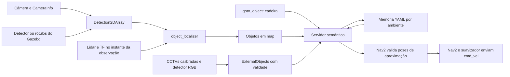

# Navegação por objetos

Para executar o mesmo fluxo com drivers físicos, veja
[o perfil real completo](real-navigation.md), incluindo calibração USB,
imagem compilada e modos de mapeamento/recuperação.

O comando recebe uma classe, como `cadeira`, estima a posição observada no
mapa, escolhe uma pose de aproximação com caminho válido e pede ao Nav2 para
chegar até ela. Depois confirma novamente a observação e salva a instância
em YAML. Uma consulta posterior pode usar essa memória, com reconfirmação.
Se a posição reconfirmada exigir outra aproximação, o servidor permite uma
correção sob o prazo original. Persistir continua exigindo a distância final válida.



No perfil LabSEA atual, as CCTVs alimentam a memória antes da consulta.
A câmera embarcada e o LiDAR continuam confirmando a chegada. Um alvo
externo válido pode mudar de posição durante a missão; a aproximação é
replanejada e a perda da posição válida cancela o destino antigo.
Veja [câmeras fixas](fixed-cameras.md) e [objetos móveis](moving-objects.md).

## Testar sem hardware

O fluxo público atual está no [guia de simulação semântica](semantic-simulation.md).
O ensaio `semantic-check` abaixo é um controle histórico com rótulos do Gazebo;
seus executores pertencem ao acervo local `extras/` e não acompanham o clone.

Na raiz do workspace:

```bash
make semantic-check
```

O teste usa a mesma imagem e os mesmos volumes da simulação. O arquivo
`extras/compose/semantic.yml` troca o comando do serviço para o launch
semântico. Nenhum driver físico é iniciado ou dispositivo montado.

O comando recria o mundo `semantic_lab`, substitui os arquivos de teste em
`extras/data/semantic-check/`.

O relatório do ensaio (acervo local: `extras/validation/semantic-2026-10-14.md`) registra método,
resultados e limitações, com JSON consolidado e figura para o relatório.

Para repetir o cadastro e a recuperação com cadeira e mesa no ambiente
importado, veja [o guia LabSEA](labsea.md). Ele usa um ensaio separado,
com móveis configuráveis e execução sem janela na Orin.

São duas etapas:

1. Iniciar SLAM, Nav2 e percepção; rejeitar consulta vazia; buscar `cadeira`,
   aproximar, reconfirmar, persistir a instância e salvar o mapa do SLAM.
2. Reiniciar na origem com mapa salvo e AMCL; consultar `chair` usando a
   instância persistida; reconfirmar sem duplicar seu ID; cancelar uma busca
   de `bed` durante movimento e conferir a parada; verificar `NOT_FOUND`
   quando uma busca curta pelo objeto ausente esgota o prazo.

O detector desse ensaio é um **oráculo de rótulos do Gazebo**. A posição é
estimada com câmera, CameraInfo, lidar e TF: `use_depth_hint:=false` impede
usar a profundidade perfeita como estimativa de posição. O diagnóstico deve
identificar fontes `lidar_*` em todas as observações localizadas.

Os sensores auxiliares de segmentação e profundidade são ativados nesse
ensaio de oráculo. O perfil visual atual os mantém desligados. A profundidade
pode aparecer como referência nas
estatísticas do localizador; ela não participa da estimativa nesta configuração.
Esse ensaio valida a integração e a associação câmera–lidar no cenário,
sem validar reconhecimento visual por um modelo aprendido.

Saídas principais:

| Arquivo | Conteúdo |
|---|---|
| `extras/data/semantic-check/learn-report.json` | Nova observação, aproximação e consulta inválida |
| `extras/data/semantic-check/recall-report.json` | Memória após reinício, cancelamento e objeto ausente |
| `extras/data/semantic-check/objects.yaml` | Instâncias, IDs, confiança e confirmações |
| `extras/data/semantic-check/map.yaml` e `map.pgm` | Mapa de ocupação salvo do SLAM |
| `extras/data/semantic-check/environment.json` e `inputs/` | Versões, hashes e cópias das entradas |
| `extras/log/semantic-*.log` | Progresso, eventos ROS e testes |

Ao terminar, a simulação semântica continua iniciada. Para consultar novamente:

```bash
docker compose --project-directory . -f docker/compose/development.yml exec -e ROBIS_BUILD_ON_START=false robis_sim \
  /usr/local/bin/robis-entrypoint ros2 run robis_semantic_navigation goto \
  cadeira --environment semantic_lab_check --timeout 150
```

Use `make down` para encerrar. A composição semântica não inicia o bridge
Foxglove automaticamente; a observação pode ser aberta em outro terminal:

```bash
docker compose --project-directory . -f docker/compose/development.yml exec -e ROBIS_BUILD_ON_START=false robis_sim \
  /usr/local/bin/robis-entrypoint ros2 launch robis_bringup foxglove.launch.py \
  use_sim_time:=true
```

## Responsabilidades

| Local | Responsabilidade |
|---|---|
| `robis_vision` | Produzir detecções e máscaras; oráculo é uma alternativa de teste |
| `object_localizer.py` | Sincronização, intrínsecos, associação lidar e transformação para `map` |
| `server.py` | Consulta, memória, busca, seleção de aproximação, reconfirmação e ação |
| `geometry.py` | Geometria e cobertura de áreas livres, sem runtime ROS |
| `store.py` | Instâncias por ambiente, escrita atômica, backup e checksum |
| `observations.py` | Observações recentes por classe, sem apagar outras classes |
| `semantic_simulation.launch.py` | Gazebo, sensores de pesquisa, SLAM ou AMCL, Nav2 e semântica |

Os arquivos principais de configuração são `semantic_navigation.yaml`,
`aliases.yaml` e `waypoints.yaml`. Os arquivos `localization_campaign_*`
são campanhas de pesquisa e não são necessários para executar esse teste.

## Aproximação e memória

O servidor gera candidatos ao redor do ponto observado e voltados para ele.
O planejador valida caminhos; o candidato com menor comprimento é escolhido.
O perfil simulado usa Regulated Pure Pursuit, o controlador validado na base.

A distância desejada é **1,4 m do ponto estimado**, com tolerância de 0,35 m.
O servidor verifica essa distância novamente após a confirmação final,
antes de declarar sucesso ou gravar a memória. O ponto estimado pelo lidar
pode representar uma superfície visível, em vez do centro geométrico do objeto.

No ensaio histórico `semantic-check`, o avaliador compara esse ponto com o
centro conhecido da cadeira, tolerando 0,7 m
como critério de integração, e confere distância física ao centro entre
1,05 m e 2,3 m na chegada. Esses limites não são uma calibração de precisão
nem uma política de segurança para uso com pessoas.
Os critérios do LabSEA com CCTVs são registrados separadamente na
[entrega com simulação](initial-release.md).

O YAML separa ambientes e classes e mantém IDs para instâncias próximas.
A reconfirmação incrementa a contagem sem criar uma cópia da mesma instância.
Uma localização que foi alcançada e não foi reconfirmada pode ser marcada
como obsoleta. Uma falha de caminho não basta para invalidar a localização.

A automação fornece, na etapa de mapa salvo, o SHA-256 do PGM como
`map_checksum`. Uma instância já vinculada a outro checksum é recusada pelo
store. No mapeamento inicial a memória ainda não tem esse vínculo; a primeira
reconfirmação com o mapa salvo o registra. O identificador atual cobre a imagem
PGM; alterações apenas da origem/resolução do YAML exigem uma política de
identificação espacial mais completa antes de uso em múltiplos mapas reais.

## Limites da implementação

- `make semantic-check` usa rótulos do simulador. O
  ensaio visual LabSEA (acervo local: `extras/validation/labsea-visual-2026-10-14.md`) também passou
  com detector adaptado e máscaras preditas. Qualidade em outros ambientes,
  falsas confirmações e imagens reais continuam exigindo ensaios.
- `bbox_cluster` pode associar um objeto ao fundo se ele não intercepta o
  plano do lidar. As opções de associação limitada e por máscara existem,
  mas precisam ser avaliadas antes de escolher um perfil físico.
- O servidor é relativamente grande e combina a máquina de estados com
  clientes ROS. Os cálculos, cache e persistência já estão separados; essa
  divisão permite testar a lógica antes de uma refatoração maior.
- A associação é por classe e proximidade. Descrições como “cadeira vermelha”
  dependem de outro backend; o fallback VLM permanece desligado neste ensaio.
- Os timeouts de missão usam tempo de parede; a física e os sensores usam
  tempo simulado. Um computador lento pode consumir o prazo com menos
  deslocamento simulado. O mapa salvo cobre o cenário observado neste teste,
  sem comprovar exploração completa do ambiente.
- Reposicionamento de uma mesa, perda das CCTVs e cancelamento foram
  ensaiados no cenário controlado. Cruzamentos de instâncias parecidas,
  oclusões longas, remoções arbitrárias e outras perdas de sensores ainda
  precisam de avaliação; veja [os limites dos objetos móveis](moving-objects.md).
- O bringup básico e um avanço curto pela ODrive foram ensaiados na Nano.
  Calibração, giros, distância externa e navegação física continuam pendentes;
  veja o [inventário](hardware.md).
